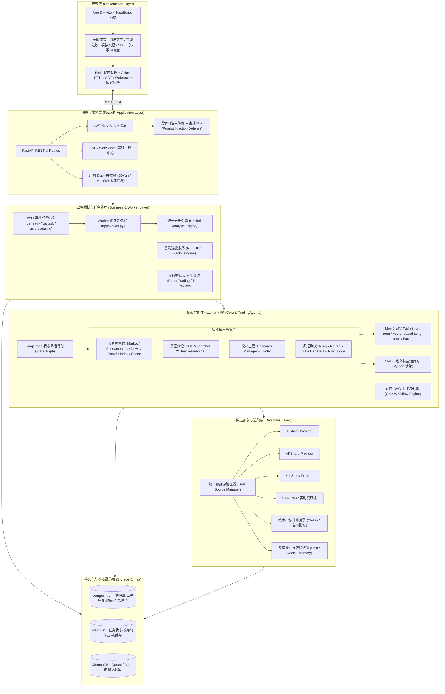
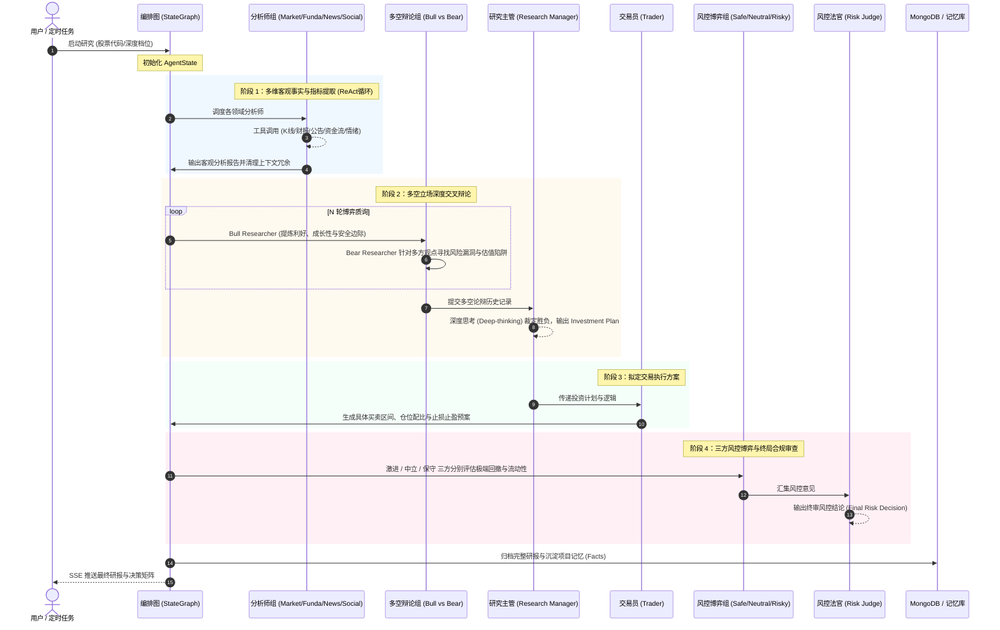
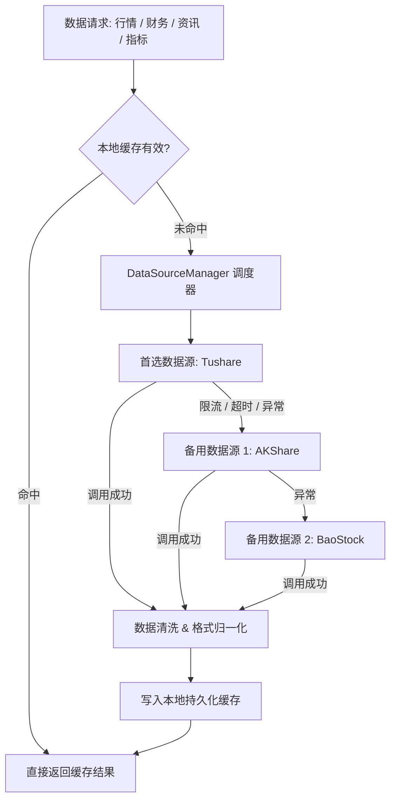

# TradingAgents-CN 系统设计与架构白皮书

> **文档版本**：v3.0  
> **适用范围**：TradingAgents-CN 社区版及核心引擎  
> **定位声明**：本项目是基于多智能体（Multi-Agent）框架的 A 股（及美港股）金融研究与学习辅助系统，所有分析与策略模拟均供学术与研发参考，不构成投资建议。

---

## 1. 系统总体定位与设计思想

传统的金融量化和大模型证券分析通常存在两大痛点：
1. **单一 LLM 幻觉与盲目追多（Sycophancy）**：单提示词生成的分析容易产生逻辑漏洞，倾向迎合用户的提问语气，缺乏客观独立的批判性推演。
2. **数据源脆弱与缺乏上下文记忆**：金融行情接口变动频繁、限流严格，且分析过程往往一次性断绝，无法像真实投研团队一样沉淀长期研报认知与事实记忆。

**TradingAgents-CN** 的核心设计思想是**“角色分工、辩论博弈、风控兜底、知行闭环”**：
- **组织结构拟真**：将人类基金与投研团队的运作模式映射为数字智能体网络——基础分析员（负责行情、技术、基本面、新闻舆情）、多空博弈研究员（多头 Bull vs 空头 Bear 循环质询辩论）、投资决策主管（根据辩论形成交易案）、三维风控裁决小组（激进、中立、保守三维风控）。
- **快慢思维结合（Dual-Speed LLM Orchestration）**：信息抽取与日常轻计算采用轻量低时延的 **快速模型（Quick-thinking LLM）**；而在辩论博弈、风险决策与研报裁决中，调度配备高推理预算的 **深度推理模型（Deep-thinking / Reasoning LLM）**。
- **前后端解耦与分布式弹性架构**：采用 Vue 3 现代响应式前端 + FastAPI 高并发 API 网关 + Redis 分布式任务队列与状态广播 + MongoDB 结构化存取 + 本地/云端向量数据库长期记忆。

---

## 2. 系统全局架构与技术栈

### 2.1 全景架构图



### 2.2 核心技术选型

| 层次 | 技术选型 | 作用与优势 |
| :--- | :--- | :--- |
| **前端 (Frontend)** | Vue 3 + TypeScript + Vite + Pinia + TailwindCSS / Element Plus | 响应式组件化设计，支持 Markdown/Echarts/KaTeX 复杂图文渲染 |
| **后端框架 (Backend)** | Python 3.11 + FastAPI + Pydantic v2 | 异步高并发支持，类型完备，契合 AI 任务生命周期管理 |
| **智能体与图编排** | LangGraph + LangChain + 自研 Core Workflow DAG | 基于有向图的循环状态流转，天然支持辩论、条件跳转与重试机制 |
| **任务队列与通信** | Redis List / Hash / PubSub + SSE (Server-Sent Events) | 轻量解耦耗时推理，客户端实时流式呈现思考与执行进度 |
| **存储体系** | MongoDB (NoSQL) + Redis (Cache) + ChromaDB/Qdrant (Vector) | 兼顾结构化配置、大段富文本分析报告、毫秒级缓存与语义检索 |
| **金融数据层** | Tushare + AKShare + BaoStock 适配聚合器 | 三路数据互补，自动降级切换，免去单数据源失效风险 |

---

## 3. 核心智能体协作机制与设计

项目的标志性特色是基于 **LangGraph StateGraph** 构建的金融多智能体协同流水线。整套推演由浅入深，分为四个核心阶段：



### 3.1 阶段 1：专业分析师集群（Analyst Phase）
- **Market Analyst（技术与行情分析师）**：抓取 K 线数据，运用量化计算引擎输出 MACD、RSI、布林带、均线多空排列、筹码集中度。
- **Fundamentals Analyst（基本面分析师）**：解析资产负债表、利润表、现金流、PE/PB/ROE、行业排名及分红历史。
- **News Analyst（新闻与事件分析师）**：解析最新公告、大宗交易、高管减持、行业政策、研报热点。
- **Social Media Analyst（舆情分析师）**：跟踪股吧、互动易、财经媒体情绪倾向。
- **Index / Sector Analyst（大盘与行业分析师）**：自包含宏观大盘走势、板块轮动与联动性，为单股定调大势环境。

### 3.2 阶段 2：多空博弈辩论（Debate Phase）
避免传统单一 Agent 直接给出结论时的倾向性偏差：
- **Bull Researcher（多头研究员）**：站在买方多头视角，挖掘被低估的催化剂、业务增量、技术买点。
- **Bear Researcher（空头研究员）**：站在空头和审慎尽调视角，尖锐质询财务水分、行业景气度下行周期、技术顶背离。
- **Research Manager（研究主管）**：由顶级深度推理模型挂载，引入历史反思机制（Reflection），综合多空双方的证据充分度与逻辑闭环，给出权威裁判结论。

### 3.3 阶段 3 & 4：执行与风控闭环（Trader & Risk Management）
- **Trader（交易执行员）**：将定性研报转化为可操作的定性定量计划（仓位建议、入场区间、止盈止损策略）。
- **Risk Management（风控审判）**：
  - `Risky Debater`：激进风险偏好（追求超额收益 Alpha，承受一定波动）。
  - `Neutral Debater`：中立风险偏好（对标基准指数 Beta）。
  - `Safe Debater`：极端保守（首要本金安全，排查一切黑天鹅）。
  - `Risk Judge`：最终风控裁决，形成全方位风险提示。

---

## 4. 混合模型智能调度（Dual-Speed LLM Architecture）

为了在保证研报深度与逻辑严密性的同时，控制 Token 成本与响应时延，系统采用了分层模型架构：

```mermaid
flowchart LR
    Task[投研任务进入] --> Classifier{任务阶段与节点性质}
    
    Classifier -->|信息提取 / 工具调用 / 单点初审| QuickLLM["快速模型 (Quick-thinking LLM)<br>例如: DeepSeek-V3, Qwen-2.5-72B, GPT-4o-mini"]
    Classifier -->|多空深度辩论 / 裁决综合 / 风控终审| DeepLLM["深度推理模型 (Deep-thinking LLM)<br>例如: DeepSeek-R1, o1/o3, 火山方舟/百炼带Reasoning模型"]
    
    QuickLLM --> HighThroughput[高吞吐、低延迟、多次工具调用迭代]
    DeepLLM --> HighLogic[长思考链 (CoT)、多步反思、深度逻辑推演]
```

### 关键工程优化
1. **动态 Reasoning Effort 调优**：系统支持根据所选分析深度（1~5 档），自适应调节模型推理思考预算（`minimal`, `low`, `medium`, `high`, `max`）。快速模型在深度档位基础上降两档，兼顾速度与成本。
2. **云端限流与串行化调度代理**：对于部分并发限制较严的服务商（如京东云、部分国产专有模型部署），内置信号量与指数退避重试（`_JDYunRateLimitedLLM`），防止多 Agent 并行请求触发 429 限流错误。

---

## 5. 数据流架构与多源容错体系

金融数据是多智能体系统的基石。`tradingagents/dataflows/` 实现了企业级的数据获取与容错调度：



- **统一数据接口 (`interface.py`)**：上层 Agent 仅需面向逻辑数据接口调用，不耦合底层数据厂商的字段命名差异。
- **自动降级与熔断机制**：Tushare Token 配额不足或接口网络超时时，系统毫秒级透明降级至开源公开的 AKShare 或 BaoStock。
- **衍生指标计算层 (`realtime_metrics.py` / `technical/`)**：封装经典技术指标（MA、EMA、MACD、KDJ、BOLL、RSI、ATR、资金流向），保障输入 LLM 的数据具备高信息密度。

---

## 6. 扩展体系：记忆系统、Skill 沙箱与 MCP

### 6.1 记忆系统 (Memory System)
系统集成短期工作流状态与长期持久化记忆体系（基于 Mem0 与向量数据库）：
- **工作流短期记忆 (AgentState)**：在单次 LangGraph 图流转中保持上下文同步，并在各节点阶段结束后通过 `Msg Clear` 节点自动剔除过时的原始消息工具调用，防止 Prompt 上下文过载爆窗。
- **项目级长期事实沉淀 (Project Memory & Facts)**：沉淀股票的历史核心逻辑、关键业绩预测验证结果、用户投资偏好。分析时自动语义检索关联历史事实注入上下文。

### 6.2 Skill 中心与运行时沙箱 (Skill Runtime)
- 允许用户或开发者以标准格式定义新的数据抓取或分析技能。
- 具备隔离的 Python 沙箱运行环境与权限校验，防止危险脚本破坏宿主机。

### 6.3 MCP 协议支持 (Model Context Protocol)
- 集成行业前沿的 MCP 协议支持，可外接标准化的数据源服务与第三方金融工具。

---

## 7. 后端服务与高并发任务调度设计

为了承载耗时较长的多智能体研究任务（通常耗时 30 秒至 3 分钟），系统采用了非阻塞的异步任务发布-订阅体系：

```mermaid
flowchart LR
    subgraph Frontend
        Browser["Vue 3 前端界面"]
    end

    subgraph FastAPI_Server["FastAPI 应用服务"]
        API["/api/v1/analysis 接口"]
        SSE["/api/v1/sse/{task_id} 进度通道"]
    end

    subgraph Redis_Infra["Redis 队列与事件流"]
        ReadyQueue[("List: qa:ready")]
        TaskHash[("Hash: qa:task:{task_id}")]
        PubSub[("Pub/Sub: task_progress:{task_id}")]
    end

    subgraph Backend_Worker["后台 Worker 进程"]
        Worker["app/worker.py"]
        GraphEngine["TradingAgentsGraph"]
    end

    Browser -->|1. 提交分析请求| API
    API -->|2. 写入任务信息| TaskHash
    API -->|3. 推送任务 ID| ReadyQueue
    API -->>|4. 返回 task_id| Browser

    Browser -->|5. 建立 SSE 连接| SSE
    SSE <-->|6. 订阅进度事件| PubSub

    ReadyQueue -->|7. 消费任务| Worker
    Worker -->|8. 驱动智能体图执行| GraphEngine
    GraphEngine -->|9. 实时汇报节点进度| PubSub
    PubSub -->|10. 流式推送到前端| Browser
```

1. **客户端发起异步任务**：用户点击分析，后端生成 `task_id`，立即返回，界面不卡死。
2. **分布式队列消费**：后台 `worker.py` 通过 Redis `BRPOP` 获取任务，解耦 Web 请求生命周期与 AI 推理计算。
3. **SSE 实时多路复用广播**：Worker 在智能体每进入一个阶段（如“行情分析完毕”、“多空进入第二轮辩论”）发布进度通知，客户端通过 HTML5 SSE 实时展示可视化动态工作流。

---

## 8. 安全防御与合规设计

作为面对真实金融场景的开源及专业级系统，安全与合规是其底层生命线：
1. **提示词防注入与意图清洗 (`Prompt Injection Defense`)**：对用户输入的主题和自定义 Prompt 进行敏感词、越狱词与系统指令覆盖检测。
2. **合规护栏与免责机制**：所有输出报告自动附加防投资建议免责声明，模型系统提示词强制对齐“客观学习与研究辅助”定位，杜绝诱导性买入/卖出保证收益等非法金融用语。
3. **数据敏感信息截断**：API Key、数据库密码在日志输出与前端序列化展示时严格脱敏（如仅保留前后 4 位）。

---

## 9. 目录工程映射总览

| 根目录/文件 | 核心职责与设计归属 |
| :--- | :--- |
| `app/` | **WebAPI 应用层**：FastAPI 路由组、鉴权中间件、数据库 Models、后台异步 Worker、系统服务 |
| `core/` | **基础智能体引擎 (Apache-2.0 开源核心)**：通用的 Workflow 引擎、通用 Agent 协议、LLM 接入、Memory 系统、Skill 运行时、沙箱环境 |
| `tradingagents/` | **金融垂直智能体逻辑**：A 股专用辩论图 (`graph/`)、多空分析师 (`agents/`)、多源金融数据流 (`dataflows/`) |
| `frontend/` | **Vue 3 前端系统**：页面视图（单股研报、智能选股、模拟交易、复盘）、Pinia 状态库、API 通信 |
| `config/` | **配置中心**：模型定义、提示词模板、系统预设、定价规则、SearXNG 配置 |
| `cli/` | **命令行工具**：提供终端形态的分析调度与快捷工具 |
| `docs/` | **文档与课程体系**：用户指南、投研学习课程体系、系统设计白皮书 |

---

## 10. 总结与架构演进展望

TradingAgents-CN 成功将软件工程中的**“高内聚低耦合”**、分布式架构中的**“异步削峰解耦”**，与 AI 前沿的**“多智能体博弈协同”**进行了深度结合。它不仅是一个 A 股分析工具，更是探索大语言模型在复杂垂直任务（金融投研）中如何通过组织化分工、多轮自洽辩论克服单点幻觉的优秀工程范式。
